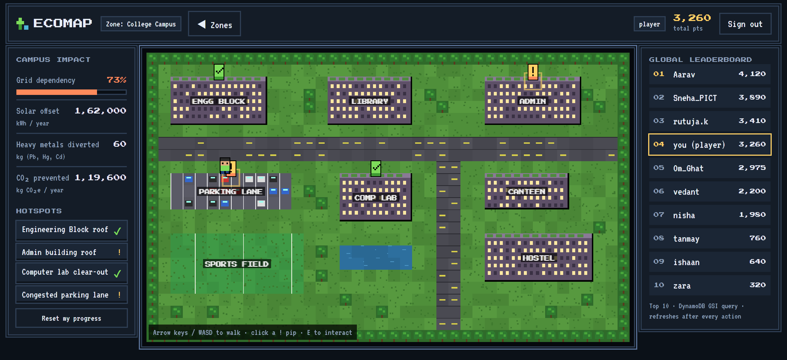
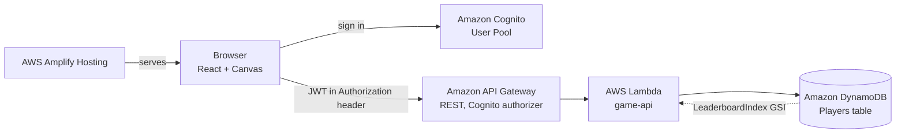

# EcoMap

EcoMap is a pixel-art map of two real micro-environments in Pune. Players walk around, click hotspots and make sustainability decisions. Each choice updates a live impact display and a global leaderboard.

- **College campus.** Rooftop solar on two buildings, routing a computer lab's e-waste, and replacing a parking lane with an EV bus stop.
- **Omkareshwar Temple.** A Ganeshotsav immersion-day scene on the Mutha ghats. Players sort Nirmalya offerings with SWaCH waste pickers, set up a collection kalash, and switch flower stalls off plastic.



## Architecture



| Layer | Service | Notes |
|---|---|---|
| Hosting | AWS Amplify Hosting | Static Vite build |
| Auth | Amazon Cognito | Email and password, 6-digit email verification |
| API | Amazon API Gateway (REST) | Every route requires a Cognito token |
| Compute | AWS Lambda (Node.js 22) | Scores actions on the server |
| Data | Amazon DynamoDB | On-demand billing |

The whole backend is defined in TypeScript with Amplify Gen 2 and AWS CDK in [amplify/backend.ts](amplify/backend.ts).

### Scoring is server-side

The browser only sends which hotspot and which choice the player picked, or where each item was sorted. The Lambda looks up points and impact in [shared/hotspots.ts](shared/hotspots.ts), the same catalog the UI renders from. A conditional write stops a hotspot from being scored twice.

### DynamoDB schema

| Key | Attribute | Type |
|---|---|---|
| Table partition key | `userId` | String (Cognito `sub`) |
| GSI `LeaderboardIndex` partition key | `leaderboardId` | String, always `GLOBAL` |
| GSI `LeaderboardIndex` sort key | `totalScore` | Number |

Each player row also holds `displayName`, `completed` and `metrics`. The leaderboard is a single `Query` on the GSI with `ScanIndexForward: false` and `Limit: 10`, so it never scans the table. `leaderboardId` is set only once a player picks a display name, which keeps unnamed accounts off the board.

### API

| Method | Path | Purpose |
|---|---|---|
| GET | /me | Profile, score, completed hotspots, metrics |
| PUT | /me | Set the display name |
| POST | /actions | Submit a choice or a sort |
| POST | /me/reset | Clear progress for replays |
| GET | /leaderboard | Top 10 |

## Running it

Requirements: Node.js 20 or newer, and an AWS account where the IAM user has AdministratorAccess.

1. Create a `.env` file in the project root:
   ```
   AWS_ACCESS_KEY_ID=...
   AWS_SECRET_ACCESS_KEY=...
   AWS_REGION=ap-south-1
   AWS_DEFAULT_REGION=ap-south-1
   ```
2. Install and test:
   ```
   npm install
   npm test
   ```
3. Bootstrap CDK once per account and region. Edit the account ID in `package.json` first if yours differs.
   ```
   npm run aws:bootstrap
   ```
4. Deploy the backend. This writes `amplify_outputs.json`.
   ```
   npm run deploy:backend
   ```
5. Build and deploy the site to Amplify Hosting:
   ```
   npm run deploy:web
   ```
   For local development, run `npm run dev` instead.

## Project layout

```
amplify/            Cognito, Lambda, DynamoDB and API Gateway definitions
shared/             Hotspot catalog and scoring rules used by both sides
src/auth/           Pixel-styled sign in, sign up, verification and reset
src/game/           Tile maps, canvas renderer, movement
src/ui/             Impact display, leaderboard, hotspot modal, sorting game
scripts/            Amplify Hosting deploy script
ui-mockups/         Screenshots of every screen
```

## Data sources

All figures are rounded approximations chosen to show scale, not measurements of a specific site. The in-game "Sources and assumptions" panel lists each one and its basis.
